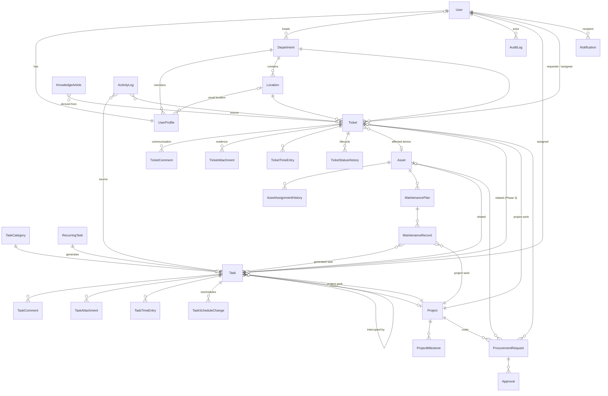

# Hotel IT Management System — Architecture

## 1. System architecture

```
 Browser (PC / tablet / phone on the hotel LAN)
        │  HTTP(S)
        ▼
 Waitress WSGI server (Windows-native)  ──►  WhiteNoise (static CSS/JS/fonts, no internet needed)
        │
        ▼
 Django 5.2 LTS application
   ├── Middleware: security headers, sessions, CSRF, auth, hotel timezone,
   │               audit-request capture, forced password change
   ├── apps.core       settings singleton, audit log, permissions, navigation
   ├── apps.accounts   users, roles, departments, locations, login throttling
   ├── apps.dashboard  metric/chart registry
   └── business apps   tasks · diary · helpdesk · notifications · assets ·
                       maintenance · projects · procurement · knowledge · reports · backups
        │                                   │
        ▼                                   ▼
 PostgreSQL (production)            Private evidence store (media_private/)
 SQLite (local development)         never web-served; streamed by permission-checked views
```

Design choices:

* **Server-rendered Django templates + Bootstrap 5.** No separate SPA/API is needed for a single-hotel deployment, and every form gets CSRF protection, server-side validation and redisplay of entered data for free. Chart.js renders charts from JSON embedded by the server.
* **All front-end libraries are vendored** in `static/vendor/` so the system runs on a LAN with no internet access.
* **Waitress** is used instead of Gunicorn/uWSGI because it runs natively on Windows.
* **Role checks are enforced in views** (`apps/core/permissions.py`). Navigation hiding is purely cosmetic.
* **Times are stored in UTC** and displayed in the hotel timezone set in System Configuration.

## 2. Modules and dependencies

| Module (Django app) | Purpose | Depends on | Phase |
|---|---|---|---|
| `core` | SystemSetting, AuditLog, permission decorators, sidebar, timezone middleware | — | 1 ✅ |
| `accounts` | UserProfile + roles, Department, Location, LoginAttempt, user administration | core | 1 ✅ |
| `dashboard` | Pluggable cards/charts computed from live data | core, accounts (+ every later module registers providers) | 1 ✅ |
| `tasks` | TaskCategory, Task, RecurringTask, TaskComment, TaskScheduleChange, TaskTimeEntry, planner | accounts, diary | 2 ✅ |
| `diary` | ActivityLog (automatic + manual entries), the single time-counting rule | accounts | 2 ✅ |
| `helpdesk` | TicketCategory, Ticket, TicketComment, TicketAttachment, TicketTimeEntry, TicketStatusHistory, SLATarget, EscalationRule, TicketEscalation | accounts, tasks, diary, evidence, notifications | 3 ✅ |
| `evidence` | Upload validation, abstract EvidenceFile model, protected serving with Range support | core | 3 ✅ |
| `notifications` | Notification centre, email after commit, duplicate suppression | accounts | 3 ✅ |
| `assets` | AssetCategory, Supplier, Asset, AssetAssignmentHistory, AssetAttachment; QR codes, service history, attention rules | accounts, evidence, helpdesk | 4 ✅ |
| `maintenance` | MaintenancePlan, MaintenanceRecord (preventive + corrective), MaintenanceAttachment; compliance | assets, tasks, notifications | 4 ✅ |
| `projects` | Project, ProjectMilestone, ProjectUpdate, ProjectAttachment; work linked via `project` FKs on Task, Ticket, MaintenanceRecord, ProcurementRequest | tasks, helpdesk, maintenance | 5 ✅ |
| `procurement` | ProcurementRequest, Approval, ProcurementAttachment | assets, helpdesk, projects | 5 ✅ |
| `knowledge` | KnowledgeArticle (troubleshooting record) + explainable matching | helpdesk, assets | 5 ✅ |
| `reports` | Daily/weekly/monthly/annual/custom reports; PDF (ReportLab), Excel (openpyxl), CSV | all | 6 ✅ |
| `backups` | Database + evidence backup, verification, restore procedure | core | 7 ✅ |

## 3. Database relationship design

All entities below exist. This is the relationship overview; field-level details are in each app's `models.py`.



Key rules:

* **No hard deletes of history.** Departments, locations and users are deactivated. Business records will use status/archival. `AuditLog` refuses updates and deletes at the ORM level.
* **Foreign keys use `PROTECT`** wherever deleting the parent would orphan history.
* **Timers and time storage** live in `apps/diary/timekeeping.py`: one running timer per person across tasks and tickets, and a task linked to a ticket stores its time as `TicketTimeEntry(via_task=…)`.
* **Time is counted once.** All totals come from `apps/diary/timecalc.py`. Counted time has exactly three sources:
  * `TaskTimeEntry`;
  * `TicketTimeEntry` (Phase 3);
  * manual `ActivityLog` entries.

  Automatic diary entries only *point at* time entries and cannot carry a duration; a database check constraint enforces this. Overlapping records for the same person are rejected when they are entered. **Decision:** time on a task linked to a ticket is recorded against the ticket.
* **Files are stored on disk**, with metadata in the database (filename, type, size, uploader, timestamp, SHA-256).
* Case-insensitive uniqueness constraints on department names/codes and locations.

## 4. Development phases

| Phase | Scope | Status |
|---|---|---|
| 1 | Foundation, authentication, roles/permissions, departments/locations, system settings, audit log, dashboard framework | ✅ Complete |
| 2 | Tasks, daily/weekly planner, recurring tasks, time tracking, interruptions, activity diary | ✅ Complete |
| 3 | Helpdesk tickets, lifecycle, evidence uploads, troubleshooting history, notifications, SLA/escalation | ✅ Complete |
| 4 | Asset register, QR codes, service history, preventive/corrective maintenance | ✅ Complete |
| 5 | Projects, procurement & approvals, knowledge base with solution suggestions | ✅ Complete |
| 6 | Reports centre (daily/weekly/monthly/annual/custom), PDF/Excel/CSV, workload analytics | ✅ Complete |
| 7 | Security review, backup/restore tooling, Windows service deployment, final documentation | ✅ Complete |

## 5. Security and backup strategy

**Implemented in Phase 1**

* PBKDF2 password hashing (Django default) with a minimum length of 10 and common- or numeric-password rejection.
* Brute-force protection: per-username lockout after N failures (configurable) plus per-IP lockout at 4×N to stop password spraying. All failures and lockouts are audited.
* Temporary passwords set by administrators must be changed at first sign-in.
* Role-based access enforced server-side. Denied access attempts are written to the audit log.
* CSRF protection on every form. Sign-out is POST-only.
* Session cookies are HttpOnly and SameSite=Lax, expire when the browser closes, and last at most one shift (8 h by default). Secure cookies, HTTPS redirect and HSTS switch on with `DJANGO_USE_HTTPS=1`.
* `X-Frame-Options: DENY`, `nosniff`, `same-origin` referrer policy.
* Secrets come only from environment variables or `.env`. The app refuses to start in production without `DJANGO_SECRET_KEY`.
* Append-only audit log recording actor, timestamp, IP, record and field-level changes.
* Rotating log files in `logs/`.
* Executable/script upload types can never be enabled in settings (validated).

**Implemented in Phase 3 (evidence)**

* Uploads are checked against the administrator's allow-list, and only types the system can verify are accepted. Script and executable types are blocked outright.
* File content must match the extension:
  * magic bytes are checked;
  * images are verified by Pillow, with a decompression-bomb limit;
  * Office files must be real OOXML without macros;
  * text files must not be binary.
* Size and count limits apply.
* Files get random storage names in `media_private/`, which is not routed by any URL.
* Downloads go only through views that check the user can see the parent ticket or task. IT-only and hidden files are restricted further.
* Files are served with `nosniff`, `Cache-Control: private, no-store`, and a CSP that sandboxes downloads. Range requests are supported.
* Images are not re-encoded, so the evidence keeps its original bytes. A SHA-256 fingerprint is stored for integrity checks.

**Implemented in Phase 7**

* Site-wide security headers (`SecurityHeadersMiddleware`):
  * a strict Content-Security-Policy (`script-src 'self'`, no inline scripts anywhere);
  * Permissions-Policy;
  * `private, no-store` on pages for signed-in users.
* Django's admin site: business records are view-only (`core.admin.ReadOnlyAdmin`), and every change made there is mirrored into the audit log (signal on `LogEntry`).
* Row locks use `select_for_update(of=("self",))`, which PostgreSQL requires with nullable joins. The test suite runs on SQLite and PostgreSQL.
* Housekeeping in `run_jobs`: expired sessions and lockout counters older than 90 days are removed. The audit log is never pruned.
* Waitress behind an HTTPS reverse proxy binds to `127.0.0.1` and trusts `X-Forwarded-Proto/For` only from it.
* Backups (`apps/backups`):
  * `engine.py` creates, verifies and restores archives:
    * zip contents: a database snapshot (`pg_dump -Fc --snapshot` from the same transaction that counts the rows, or the SQLite backup API), `media/`, and `manifest.json` with SHA-256 fingerprints, row counts and applied migrations;
    * a `.sha256` sidecar file;
    * zip-slip protection;
    * a test restore into a temporary SQLite file or the `BACKUP_VERIFY_DB` scratch database.
  * `services.py` handles the rest:
    * records and locking;
    * copying to `BACKUP_COPY_TO`, with the copy's fingerprint checked;
    * rotation;
    * failure notifications;
    * health figures for the page, the dashboard and preflight.
  * Commands: `backup`, `verify_backup`, `restore_backup` (safety backup first) and `preflight`.
* Operations: `scripts/install.ps1`, `register_tasks.ps1`, `update.ps1` and `start_server.ps1`. See [DEPLOYMENT.md](DEPLOYMENT.md), [BACKUP_AND_RESTORE.md](BACKUP_AND_RESTORE.md) and [SECURITY.md](SECURITY.md).
